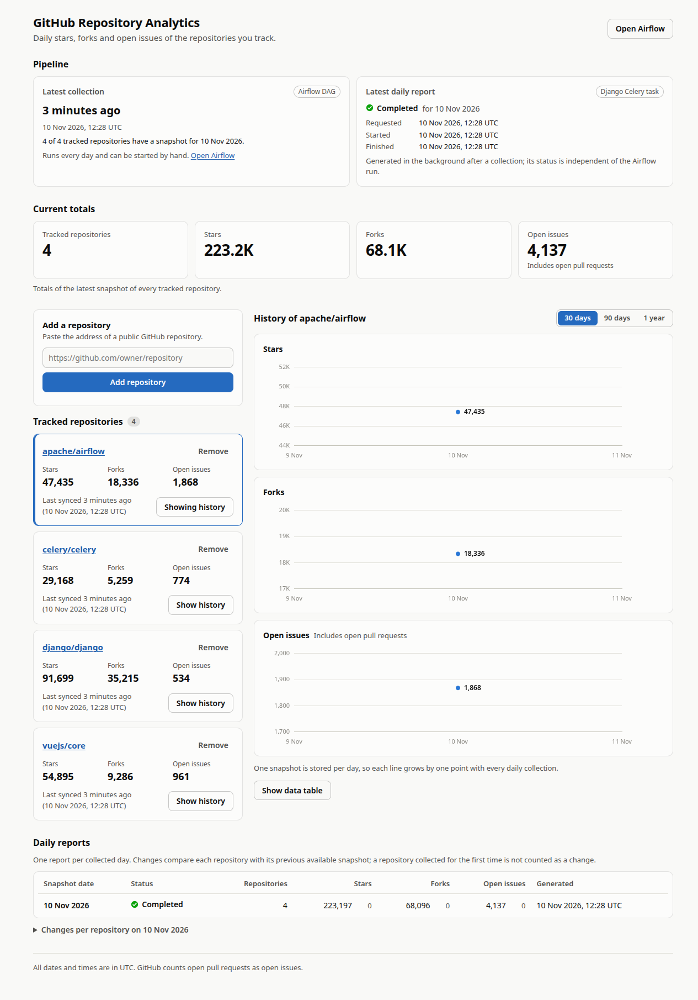
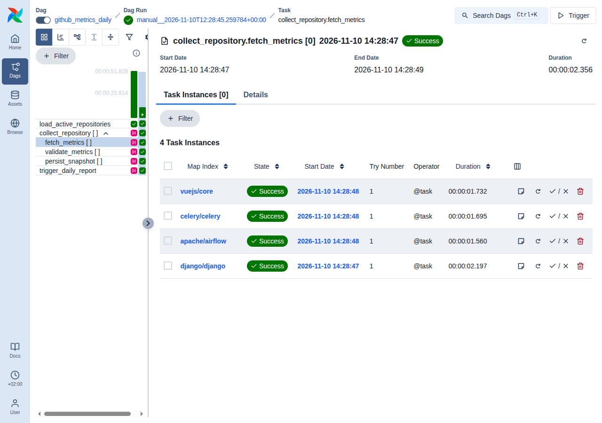

# GitHub Repository Analytics Platform

Track public GitHub repositories and watch their stars, forks and open issues over time.

You paste a repository URL into a dashboard; from then on an Apache Airflow pipeline collects its
metrics once a day, one dynamically mapped task chain per repository, and a Django Celery worker
turns each day's snapshots into a report.

The project is a compact, locally runnable example of workflow orchestration (Airflow 3, TaskFlow,
dynamic task mapping, CeleryExecutor), asynchronous processing (Django + Celery), REST API design
(Django REST Framework) and a small Vue 3 front end, all wired together with Docker Compose.



> This is a local demonstration project. It has no user accounts and is not hardened for
> production; the limits are listed in
> [docs/ARCHITECTURE.md](docs/ARCHITECTURE.md#security-limits-of-the-local-setup).

## Contents

- [Main features](#main-features)
- [Technology stack](#technology-stack)
- [Prerequisites](#prerequisites)
- [Quick start](#quick-start)
- [Environment setup](#environment-setup)
- [Service URLs and ports](#service-urls-and-ports)
- [How to use the application](#how-to-use-the-application)
- [Airflow](#airflow): opening the UI, triggering the DAG, automatic scheduling
- [Docker commands](#docker-commands)
- [How to run migrations](#how-to-run-migrations)
- [How to run tests](#how-to-run-tests)
- [Troubleshooting](#troubleshooting)
- [Documentation](#documentation)

## Main features

- **Repository management in the browser.** Add a repository by URL, see every tracked repository
  with its current metrics and last successful sync, remove it, and restore it later with its
  history intact.
- **Validation on the backend, before anything is saved.** The URL is parsed (never fetched), the
  repository is looked up through the official GitHub REST API, and it is stored only if it exists
  and is public. Duplicates, private or missing repositories, rate limits and GitHub outages each
  get their own clear answer.
- **A daily Airflow DAG with dynamic task mapping.** The DAG asks Django for the active
  repositories at run time and expands into one fetch, validate and persist chain per repository.
  Adding or removing a repository never requires touching the DAG.
- **Idempotent by construction.** One snapshot per repository per day is guaranteed by a database
  constraint, so retries and repeated runs cannot create duplicates.
- **An asynchronous daily report.** After a successful collection Airflow asks Django for a
  report; a separate Django Celery worker computes totals and day-over-day changes.
- **Two Celery systems, cleanly separated.** Airflow's CeleryExecutor and Django's Celery share one
  Redis server but use different logical databases, queues and workers.
- **A dashboard that shows what is going on.** Current totals, one chart per metric, the latest
  collection, and the report's own status (queued, running, completed, failed), refreshed
  automatically.
- **Tests for every part**, all running in containers: 239 for the backend, 131 for the pipeline
  (including whole DAG runs), 99 for the front end.

## Technology stack

| Area | Technology | Version |
|---|---|---|
| Backend | Python, Django, Django REST Framework | 3.13, 5.2 LTS, 3.18 |
| Orchestration | Apache Airflow with the TaskFlow API and CeleryExecutor | 3.3.2 |
| Background jobs | Celery (Airflow's Celery provider 3.24 on one side, Django integration on the other) | 5.6 |
| Database | PostgreSQL | 18 |
| Message broker | Redis | 7.4 |
| Front end | Vue 3 (Composition API), Vite, Chart.js | 3.5, 8, 4 |
| Web server | gunicorn (API), nginx (dashboard) | 26, 1.30 |
| Tests | pytest, pytest-django, responses, Vitest, Vue Test Utils | |
| Tooling | Docker Compose, ruff, ESLint | |

Why these versions, and why not the very newest of each, is explained in
[docs/DECISIONS.md](docs/DECISIONS.md#1-version-policy-newest-release-line-that-already-has-patch-releases).

## Prerequisites

- **Docker** with the **Compose plugin**, version 2.14 or newer (the minimum Airflow's own Compose
  setup asks for). The project was developed with Docker 29 and Compose 5.
- About **2 GB of free memory** for the containers (the stack uses about 1.4 GB when idle) and
  about **5 GB of disk** for the images. The Airflow image alone is about 3 GB.
- A POSIX shell with **`openssl`** for the one-time bootstrap script. On Windows use WSL or Git Bash.
- Ports **3000**, **8000** and **8080** free on the host (they can be changed in `.env`).
- Optional: `make`, for the shortcuts in the `Makefile`.

Nothing else is installed on the host: no Python, no virtual environment, no Node.js.

## Quick start

```bash
git clone https://github.com/flokos/github-repo-analytics.git
cd github-repo-analytics

./scripts/bootstrap-env.sh       # once: creates .env with freshly generated secrets
docker compose up --build        # add --detach to get your terminal back
```

The first build downloads the images and takes a few minutes. After that, a start takes about two
and a half minutes; Airflow is the slowest part. The stack is ready when `docker compose ps` shows
every service as `healthy` (and `backend-migrate` and `airflow-init` as `Exited (0)`).

Then:

1. Open the dashboard at <http://localhost:3000> and add a repository, for example
   `https://github.com/django/django`.
2. Start a collection right away instead of waiting for 06:00 UTC:
   `docker compose exec airflow-scheduler airflow dags trigger github_metrics_daily`
3. Watch the dashboard: within about half a minute the repository has metrics, a first chart point
   and a completed daily report.

The bootstrap script prints the Airflow login. To see it again: `grep '^AIRFLOW_ADMIN_' .env`.

## Environment setup

All configuration lives in `.env`, which `scripts/bootstrap-env.sh` creates from
[`.env.example`](.env.example). The script fills every secret with a random value and never
overwrites an existing `.env`. The file is git-ignored; no working credential exists in the
repository.

| Variable | Purpose | Default |
|---|---|---|
| `GITHUB_TOKEN` | **Optional.** Raises GitHub's rate limit from 60 to 5,000 requests per hour. A fine-grained token with read-only access to public repositories is enough | empty |
| `PIPELINE_SCHEDULE_CRON`, `PIPELINE_SCHEDULE_TIMEZONE` | When the daily collection runs | `0 6 * * *`, `UTC` |
| `AIRFLOW_WORKER_CONCURRENCY` | Task slots of the Airflow Celery worker; lower it on small machines | `4` |
| `FRONTEND_PORT`, `API_PORT`, `AIRFLOW_PORT` | Host ports, bound to 127.0.0.1 | `3000`, `8000`, `8080` |
| `CORS_ALLOWED_ORIGINS` | Origins allowed to call the API cross-origin (only the Vite dev server needs this) | `http://localhost:5173`, `http://127.0.0.1:5173` |
| `REPOSITORY_CREATE_THROTTLE` | Rate limit for adding repositories | `30/min` |
| `AIRFLOW_ADMIN_USERNAME`, `AIRFLOW_ADMIN_PASSWORD` | Airflow UI login, created on first start | `admin`, generated |
| `INTERNAL_API_TOKEN` | Shared secret between Airflow and Django's internal API | generated |
| `DJANGO_SECRET_KEY`, `AIRFLOW_FERNET_KEY`, `AIRFLOW_JWT_SECRET`, `AIRFLOW_API_SECRET_KEY` | Framework secrets | generated |
| `POSTGRES_SUPERUSER_PASSWORD`, `ANALYTICS_DB_*`, `AIRFLOW_DB_*` | Database names, roles and passwords | generated passwords |

After editing `.env`, run `docker compose up --detach` to apply the change. Database passwords and
the Airflow login are only used when the data volumes are first created; to change them later,
start over with `docker compose down --volumes`.

## Service URLs and ports

| What | URL | Notes |
|---|---|---|
| Dashboard | <http://localhost:3000> | nginx serving the Vue app |
| REST API through the dashboard's origin | <http://localhost:3000/api/> | Public endpoints only |
| REST API directly | <http://localhost:8000/api/> | Public and internal endpoints; handy for `curl` |
| Airflow UI and API | <http://localhost:8080> | Login from `.env` |

PostgreSQL and Redis are not published on the host. Every published port is bound to
`127.0.0.1`. The endpoints are documented in [docs/API.md](docs/API.md).

## How to use the application

Everything a user needs is in the dashboard; neither the Django admin nor the Airflow UI is
required.

| To | Do this |
|---|---|
| Track a repository | Paste its address (`https://github.com/owner/name`) under **Add a repository**. Django checks it with GitHub before saving. A new repository shows "No metrics yet" until the next collection |
| See current metrics | Each card under **Tracked repositories** shows stars, forks, open issues and the last successful sync. **Current totals** adds them up |
| See history | Choose **Show history** on a card. One chart per metric, with 30 days, 90 days or 1 year, and **Show data table** for the numbers |
| Stop tracking | **Remove** on a card. The repository leaves the daily collection; its history is kept |
| Track it again | Open **Removed repositories** below the list and choose **Restore** |
| Check the pipeline | **Pipeline** shows the latest collection and the latest daily report with its own status. **Daily reports** lists totals and changes per day |

Things worth knowing:

- GitHub's "open issues" number **includes open pull requests**. The dashboard labels it that way.
- One snapshot is stored per repository per UTC day, so a chart grows by one point a day. All
  dates and times in the dashboard are UTC.
- If GitHub answers "not found", the dashboard says the repository may not exist **or** may be
  private. GitHub gives the same answer for both, so the application does not guess.

## Airflow

### How to open the Airflow UI

<http://localhost:8080>, with the username and password from `.env`:

```bash
grep '^AIRFLOW_ADMIN_' .env
```

Open the DAG **github_metrics_daily**. The grid shows one column per run; `collect_repository [ ]`
is the mapped task group, and selecting one of its tasks in a run lists one task instance per
repository, labelled with the repository's name.



### How to trigger the DAG manually

Any of these starts a run now:

- In the UI: open `github_metrics_daily` and press **Trigger** (top right).
- From the command line: `docker compose exec airflow-scheduler airflow dags trigger github_metrics_daily`
  (or `make trigger`).
- Through Airflow's REST API; the commands are in
  [docs/AIRFLOW.md](docs/AIRFLOW.md#manual-triggering).

A run with a handful of repositories takes 10 to 30 seconds.

### How automatic scheduling works

- The DAG runs **every day at 06:00 UTC** (`CronTriggerTimetable("0 6 * * *", timezone="UTC")`).
  The Airflow scheduler creates the runs by itself; nothing has to be clicked, and the DAG is
  active as soon as it is first parsed.
- Each run asks Django for the repositories that are active **at that moment**, so changes made in
  the dashboard apply to the next run automatically.
- `catchup=False`: missed days are never made up for. When the stack starts for the first time, or
  after it was switched off across 06:00 UTC, Airflow creates one run for the most recent 06:00 UTC
  that has passed, and then continues daily. (GitHub only reports current numbers, so a run "for
  yesterday" could not fetch yesterday's values anyway.)
- Only one run is active at a time. A run fails visibly if any repository could not be collected,
  and in that case no report is requested.
- To see the scheduler at work without waiting a day, set `PIPELINE_SCHEDULE_CRON=*/2 * * * *` in
  `.env`, run `docker compose up --detach`, and watch runs appear every two minutes. Set it back
  afterwards.

Details: [docs/AIRFLOW.md](docs/AIRFLOW.md).

## Docker commands

| To | Run | Or |
|---|---|---|
| Build and start | `docker compose up --build --detach` | `make up` |
| See status and health | `docker compose ps` | `make ps` |
| Follow all logs | `docker compose logs --follow --tail 100` | `make logs` |
| Follow one service | `docker compose logs --follow airflow-worker` | |
| Stop, keep data | `docker compose down` | `make down` |
| Stop and delete all data | `docker compose down --volumes --remove-orphans` | `make clean` |
| Rebuild after changing backend code | `docker compose up --build --detach api django-worker` | |
| Rebuild after changing the dashboard | `docker compose up --build --detach frontend` | |

Data lives in two named volumes (`postgres-data`, `airflow-logs`) and survives `down` and restarts.

The services, and which containers run permanently, are described in
[docs/ARCHITECTURE.md](docs/ARCHITECTURE.md#services).

## How to run migrations

You normally do not have to: the `backend-migrate` service applies Django's migrations on every
start, before the API and the worker come up, and `airflow-init` does the same for Airflow's
database.

```bash
docker compose run --rm backend-migrate                                              # apply by hand
docker compose run --rm backend-migrate python manage.py showmigrations analytics    # list them
```

Creating a new migration after a model change is described in
[docs/DEVELOPMENT.md](docs/DEVELOPMENT.md#migrations).

## How to run tests

```bash
make test
```

or, one suite at a time:

```bash
docker compose --profile test run --rm --build backend-tests     # Django: ruff, migration check, pytest
docker compose --profile test run --rm --build airflow-tests     # DAG: ruff, pytest incl. whole DAG runs
docker compose --profile test run --rm --build frontend-tests    # Vue: ESLint, Vitest
```

Each suite runs in its own container and lints before it tests. No test contacts the real GitHub;
HTTP is mocked and any unregistered request fails the test. What each suite covers is listed in
[docs/DEVELOPMENT.md](docs/DEVELOPMENT.md#tests).

## Troubleshooting

| Symptom | Cause and fix |
|---|---|
| `Missing .env - run ./scripts/bootstrap-env.sh first` | Compose found no `.env`, or a required secret is empty. Run the bootstrap script |
| `port is already allocated` | Another program uses 3000, 8000 or 8080. Change `FRONTEND_PORT`, `API_PORT` or `AIRFLOW_PORT` in `.env` |
| Airflow services stay `starting` for minutes, or the machine swaps | Not enough free memory. Close other programs, or lower `AIRFLOW_WORKER_CONCURRENCY` in `.env`. Check with `docker compose ps` and `docker compose logs airflow-apiserver` |
| The DAG does not appear in Airflow | `docker compose exec airflow-scheduler airflow dags list-import-errors`. The DAG folder is mounted read-only into containers that run as another user, so the files under `airflow/dags` must be world-readable; on SELinux systems add `:z` to that volume in `compose.yaml` |
| A run does not progress | If the run itself is `queued`, another run is still active (only one runs at a time). If its tasks stay `queued`, `airflow-worker` is not running: `docker compose ps airflow-worker` |
| Tasks fail with `Signature verification failed` or `Invalid auth token` | The Airflow containers do not share the same secrets, usually because `.env` changed while some were running. `docker compose up --detach --force-recreate` |
| A task fails with `RepositoryUnavailableError` | GitHub no longer shows that repository (deleted, renamed away, or made private). Remove it in the dashboard; the next run succeeds |
| A task fails with `RateLimitExhaustedError`, or adding a repository answers "rate limit" | The 60 requests per hour for anonymous clients are used up. Wait, or set `GITHUB_TOKEN` in `.env` and run `docker compose up --detach` |
| A task fails with `InternalApiAuthError` | `INTERNAL_API_TOKEN` differs between Django and Airflow. `docker compose up --detach --force-recreate` |
| The report stays **Queued** | `django-worker` is not running: `docker compose ps django-worker`, `docker compose logs django-worker`. It completes as soon as the worker is back |
| The DAG run is green but the report failed | They are separate on purpose. The reason is in the dashboard and in `error_message` at `/api/reports/`; the next run requests the report again |
| Times in the Airflow UI look two hours off | The UI shows your browser's timezone by default; the schedule is defined in UTC |
| Changed a database password or the Airflow login in `.env`, and now nothing can connect | Those are applied only when the volumes are created. Restore the old values, or start over with `make clean` |
| Something is in a state you cannot explain | `make clean && make up` rebuilds everything from scratch (this deletes all collected data) |

## Documentation

| Document | Contents |
|---|---|
| [docs/ARCHITECTURE.md](docs/ARCHITECTURE.md) | Services, responsibilities, the Django application's structure, how the parts talk to each other, database and queue design, security limits |
| [docs/DIAGRAMS.md](docs/DIAGRAMS.md) | Mermaid diagrams: system, repository validation, DAG execution, report generation, data model |
| [docs/API.md](docs/API.md) | Every public and internal endpoint with examples, status codes and error cases |
| [docs/AIRFLOW.md](docs/AIRFLOW.md) | The DAG: scheduling, TaskFlow, dynamic task mapping, CeleryExecutor, retries, manual runs, reprocessing |
| [docs/CELERY.md](docs/CELERY.md) | Django's Celery integration and how it is kept apart from Airflow's CeleryExecutor |
| [docs/DEVELOPMENT.md](docs/DEVELOPMENT.md) | Project structure, commands, migrations, tests, linting, adding a feature |
| [docs/DECISIONS.md](docs/DECISIONS.md) | The significant decisions, with reasons and trade-offs |
