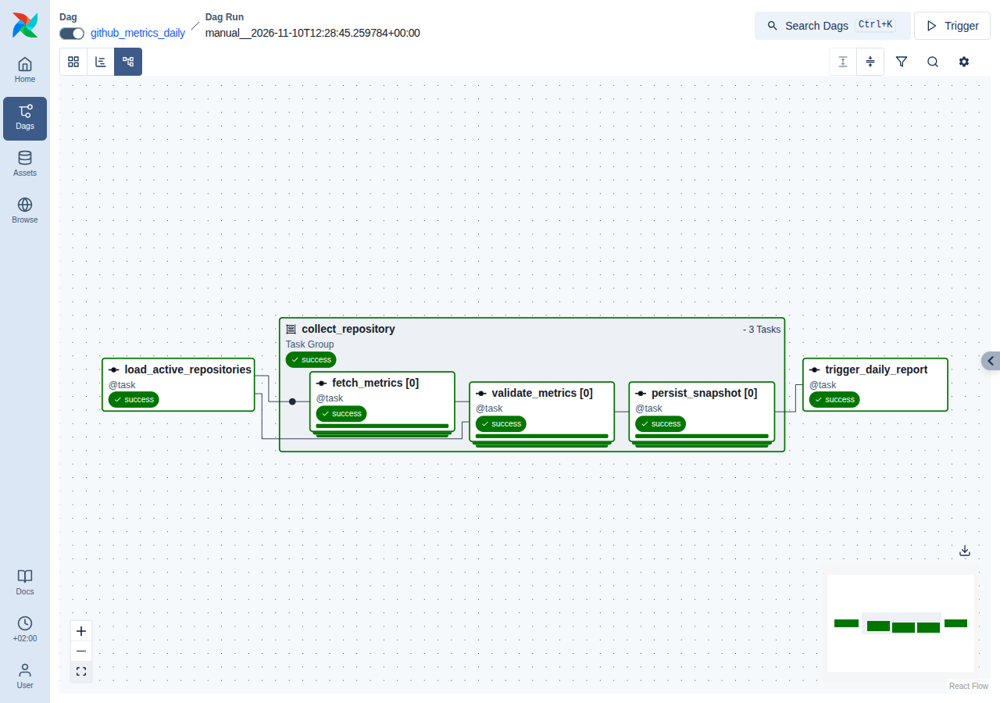
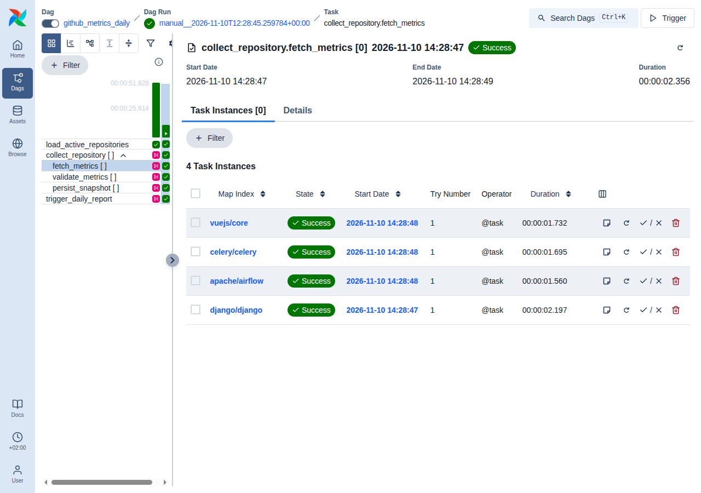

# Airflow

The daily collection is one Airflow 3 DAG, `github_metrics_daily`, running on the CeleryExecutor.
This document describes it as implemented in
[`airflow/dags/github_metrics_daily.py`](../airflow/dags/github_metrics_daily.py) and
[`airflow/dags/github_analytics/`](../airflow/dags/github_analytics/). How Airflow's Celery
relates to Django's is in [CELERY.md](CELERY.md).

## DAG structure

```
load_active_repositories
        │   list of N repositories (from Django, at run time)
        ▼
collect_repository  ── mapped task group: one instance per repository ──┐
│   fetch_metrics  ──►  validate_metrics  ──►  persist_snapshot          │
└────────────────────────────────────────────────────────────────────────┘
        │
        ▼
trigger_daily_report   (trigger rule: none_failed)
```

| Task | What it does | Calls |
|---|---|---|
| `load_active_repositories` | Asks Django which repositories are active right now | `GET /api/internal/repositories/active/` |
| `collect_repository.fetch_metrics` | Reads one repository's stars, forks and open issues | `GET https://api.github.com/repos/{owner}/{name}` |
| `collect_repository.validate_metrics` | Checks the metrics before they are stored | nothing (pure logic) |
| `collect_repository.persist_snapshot` | Stores the snapshot through Django | `POST /api/internal/snapshots/` |
| `trigger_daily_report` | Asks Django to generate the day's report | `POST /api/internal/reports/` |

The DAG file contains no repository names. The work list is whatever Django returns when the run
starts, so a repository added or removed in the dashboard is picked up by the next run without
editing or redeploying anything.

The task functions in the DAG file are two or three lines each. The logic lives in the helper
package `github_analytics`, which has no Airflow imports:

| Module | Contents |
|---|---|
| `pipeline.py` | The four steps as plain functions |
| `clients.py` | `GitHubClient` and `InternalApiClient`: HTTP with timeouts, outcomes translated into typed errors |
| `validation.py` | `validate_metrics` |
| `errors.py` | Error types, split into `PermanentError` and `TransientError` |

Parsing the DAG file performs no network or database access. It reads two environment variables
for the schedule and nothing else; connections are resolved inside tasks.

## Scheduling

```python
schedule=CronTriggerTimetable("0 6 * * *", timezone="UTC"),
start_date=pendulum.datetime(2026, 1, 1, tz="UTC"),
catchup=False,
max_active_runs=1,
dagrun_timeout=timedelta(minutes=30),
is_paused_upon_creation=False,
```

- **Every day at 06:00 UTC**, with an explicit timezone on both the timetable and the start date.
- **It runs without any manual step.** `is_paused_upon_creation=False` means the DAG is active as
  soon as the DAG processor has parsed it.
- **`catchup=False`**: Airflow never creates runs for days that were missed. What it does do, when
  the stack starts for the first time or after it was down across one or more scheduled times, is
  create **one** run for the most recent 06:00 UTC that has already passed, and then one per day.
  On a brand-new stack that first run finds no repositories and succeeds without doing anything.
- **`max_active_runs=1`**: runs never overlap. A manual run triggered while another is active
  waits in `queued` until it finishes.
- **`dagrun_timeout`**: a run that is still going after 30 minutes is failed.

Catching up would be meaningless here, not just unwanted: GitHub's API returns current values
only, so a run "for last Tuesday" could only fetch today's numbers.

The cron expression and timezone can be changed without touching the DAG file, through
`PIPELINE_SCHEDULE_CRON` and `PIPELINE_SCHEDULE_TIMEZONE` in `.env`, followed by
`docker compose up --detach`. Setting the cron to `*/2 * * * *` is a quick way to watch the
scheduler create runs by itself.

## TaskFlow API

The DAG is written with the TaskFlow decorators from `airflow.sdk`: `@dag`, `@task` and
`@task_group`. Tasks are ordinary Python functions; passing the return value of one as an
argument to another both declares the dependency and moves the data through XCom.

```python
repositories = load_active_repositories()
results = collect_repository.expand(repository=repositories)
trigger_daily_report(results)
```

What travels through XCom is deliberately small:

| From | Value |
|---|---|
| `load_active_repositories` | A list of `{id, github_id, owner, name, full_name}` |
| `fetch_metrics` | Seven fields: GitHub id, visibility flags, three counts, a timestamp |
| `validate_metrics` | The snapshot to store: repository id, name, three counts, a timestamp |
| `persist_snapshot` | `{repository_id, snapshot_date, outcome}` |
| `trigger_daily_report` | `[{report_id, snapshot_date, status}]` |

No token is ever part of a return value. The GitHub response itself (several kilobytes per
repository) is reduced to the metrics inside `fetch_metrics` and never stored.

## Dynamic Task Mapping

`collect_repository.expand(repository=repositories)` creates one instance of the task group for
each element of the list that `load_active_repositories` returned. The number of instances is
decided at run time, by data.

Mapping a **task group** rather than three separate tasks gives each repository its own chain:
`validate_metrics[django/django]` depends only on `fetch_metrics[django/django]`. If the fetch for
one repository fails, only that repository's later steps are affected, and the other repositories
still have their snapshots stored.

Each mapped instance is labelled with the repository it handles (`map_index_template`), so the
Airflow UI shows `django/django` and `apache/airflow` instead of `0` and `1`.

| Situation | Behaviour |
|---|---|
| N repositories | N instances of each of the three tasks |
| No repositories | The three tasks are marked `skipped`, `trigger_daily_report` skips itself, the run succeeds |
| More than 1024 repositories | `load_active_repositories` fails: Airflow's `max_map_length`. At that scale repositories would be processed in batches |

One detail worth knowing: when a mapped task expanded into exactly **one** instance, Airflow hands
a downstream task that instance's bare value instead of a one-element list (and `None` when it
expanded into none). `pipeline.as_result_list` normalises the three cases, and
`tests/test_dag_runs.py` runs the DAG with zero, one and two repositories.

## CeleryExecutor

Airflow is configured with `AIRFLOW__CORE__EXECUTOR=CeleryExecutor`, as in Airflow's reference
Compose file.

| Setting | Value |
|---|---|
| Broker | `redis://redis:6379/0` |
| Result backend | `db+postgresql+psycopg2://…@postgres:5432/airflow` (PostgreSQL, table `celery_taskmeta`) |
| Default queue | `airflow_tasks` (`AIRFLOW__OPERATORS__DEFAULT_QUEUE`) |
| Worker concurrency | 4 task slots (`AIRFLOW_WORKER_CONCURRENCY` in `.env`) |
| Parallelism | 8 task instances across the installation |

How a task instance gets executed:

1. The **scheduler** decides that a task instance is ready and publishes a message to the
   `airflow_tasks` queue on Redis database 0.
2. The **worker** (`airflow celery worker`) receives it and starts the task in a subprocess.
3. That process loads the DAG file from its own copy of the DAG folder, runs the task, and reports
   state, XCom and heartbeats to the **API server's execution API**. In Airflow 3 workers do not
   connect to the metadata database.
4. The Celery result is written to PostgreSQL, where the scheduler reads it.

Three secrets (`AIRFLOW__API_AUTH__JWT_SECRET`, `AIRFLOW__API__SECRET_KEY`,
`AIRFLOW__CORE__FERNET_KEY`) are set explicitly and identically on every Airflow service. Left to
their defaults, each container would generate its own, and the worker's calls to the API server
would be rejected.

### Components

| Service | Command | Needed because |
|---|---|---|
| `airflow-init` | migrates the database, creates the UI login, verifies the migration | One-shot preparation |
| `airflow-apiserver` | `api-server` | UI, REST API and the execution API |
| `airflow-scheduler` | `scheduler` | Creates runs and schedules task instances |
| `airflow-dag-processor` | `dag-processor` | Parses DAG files; a separate process in Airflow 3 |
| `airflow-worker` | `celery worker` | Executes task instances |

There is no triggerer (the DAG has no deferrable tasks) and no Flower.

## Worker execution

The GitHub token and the internal API token are given to the worker, and only to the worker, as
Airflow connections defined in environment variables:

| Connection id | Environment variable | Used for |
|---|---|---|
| `github_api` | `AIRFLOW_CONN_GITHUB_API` | `https://api.github.com`, token in `password` (empty when no `GITHUB_TOKEN` is set) |
| `django_internal_api` | `AIRFLOW_CONN_DJANGO_INTERNAL_API` | `http://api:8000`, internal token in `password` |

Tasks read them with `Connection.get(...)` at run time. They are not stored in the metadata
database, Airflow masks connection passwords in task logs, and neither client logs request
headers. On any other Airflow container, `airflow connections get github_api` answers
"Connection not found".

To confirm that mapped tasks really run on the Celery worker:

```bash
# Every task instance of the latest run, with the host that executed it and the queue it used.
docker compose exec airflow-worker hostname
docker compose exec postgres psql -U postgres airflow -c "
  select task_id, rendered_map_index as repository, state, hostname, queue
  from task_instance
  where run_id = (select run_id from dag_run order by run_after desc limit 1)
  order by task_id, map_index"
```

```text
               task_id               |   repository   |  state  |   hostname   |     queue
-------------------------------------+----------------+---------+--------------+---------------
 collect_repository.fetch_metrics    | django/django  | success | cc4169b48221 | airflow_tasks
 collect_repository.fetch_metrics    | apache/airflow | success | cc4169b48221 | airflow_tasks
 ...
 load_active_repositories            |                | success | cc4169b48221 | airflow_tasks
 trigger_daily_report                |                | success | cc4169b48221 | airflow_tasks
```

The hostname in every row is the `airflow-worker` container's. Two more ways to see it:

```bash
# The worker's log shows one Celery message per task instance.
docker compose logs airflow-worker | grep execute_workload

# With the worker stopped, a triggered run does not progress: its first task stays queued.
# It proceeds as soon as the worker is back.
docker compose stop airflow-worker
docker compose exec airflow-scheduler airflow dags trigger github_metrics_daily
docker compose exec redis redis-cli -n 0 llen airflow_tasks     # 1: a message is waiting
docker compose start airflow-worker
```

In the Airflow UI the same information is on a task instance's details: its hostname is the
worker's, and its queue is `airflow_tasks`.

Concurrent GitHub requests are bounded: `fetch_metrics` sets `max_active_tis_per_dagrun=4`, and
with `max_active_runs=1` that is the limit for the whole installation.

## Retries and failure handling

Defaults for every task:

| Setting | Value |
|---|---|
| `retries` | 3 |
| `retry_delay` | 30 seconds |
| `retry_exponential_backoff` | 2.0, so retries come after 30 s, 60 s and 120 s |
| `max_retry_delay` | 5 minutes |
| `execution_timeout` | 2 minutes per attempt |

On top of that, a retry policy (`ExceptionRetryPolicy`, Airflow 3.3) looks at **what** failed.
Errors derived from `PermanentError` fail the task at once; everything else goes through the
retries above. `validate_metrics` has `retries=0`: it is deterministic, so a second attempt would
give the same answer.

| What happens | Error type | Result |
|---|---|---|
| GitHub answers 404, 451, or 403 without rate-limit headers | `RepositoryUnavailableError` (permanent) | Fails at once; the log says to remove the repository or restore access |
| GitHub answers 401 | `GitHubAuthError` (permanent) | Fails at once; check `GITHUB_TOKEN` |
| Rate limit that resets within 4 minutes | `RateLimitedError` (transient) | Retried with backoff |
| Rate limit that resets later than the retries can wait | `RateLimitExhaustedError` (permanent) | Fails at once, with the reset time and a hint to set `GITHUB_TOKEN` |
| GitHub timeout, connection error, 5xx, unreadable body | `GitHubUnavailableError` (transient) | Retried with backoff |
| Metrics have the wrong types, are negative, belong to another GitHub id, or the repository is no longer public | `InvalidMetricsError` (permanent) | Fails at once; nothing is stored for that repository |
| Django answers 401 or 403 | `InternalApiAuthError` (permanent) | Fails at once; `INTERNAL_API_TOKEN` differs between Django and Airflow |
| Django answers another 4xx | `InternalApiRejectedError` (permanent) | Fails at once, with Django's error code and message |
| Django times out, is unreachable, or answers 5xx | `InternalApiUnavailableError` (transient) | Retried with backoff |
| Anything unexpected | any other exception | Retried with backoff |

What a failure means for the run:

| Situation | Other repositories | `trigger_daily_report` | DAG run |
|---|---|---|---|
| Every repository succeeds | | runs, report requested | `success` |
| One repository fails for good | still collected and stored | `upstream_failed`, **no report requested** | `failed` |
| `load_active_repositories` fails | nothing runs | `upstream_failed` | `failed` |
| No active repositories | | skips itself | `success` |

A run is therefore never reported as successful when a repository was not collected.
`trigger_daily_report` uses the `none_failed` trigger rule, which is what lets it run after an
all-skipped (empty) mapping but not after any failure.

The validation step includes an identity check: the id GitHub returns must equal the `github_id`
recorded when the repository was added. Metrics are fetched by owner and name, and GitHub allows
the old name of a renamed repository to be taken by a different one; without the check, that
repository's numbers would be recorded silently.

## Airflow status and report status

`trigger_daily_report` succeeds as soon as Django answers 202 Accepted. It does not wait for the
report.

| | Airflow DAG run | Daily report |
|---|---|---|
| Lives in | Airflow's metadata database | `DailyReport.status` in Django |
| Shown in | The Airflow UI | The dashboard and `GET /api/reports/` |
| States | `queued`, `running`, `success`, `failed` | `queued`, `running`, `completed`, `failed` |
| `success` / `completed` means | Every repository was collected and the report was requested | The report was generated |

A successful run with a failed or still-queued report is possible and visible as exactly that. See
[CELERY.md](CELERY.md) for the report's side.

## Opening the Airflow UI

<http://localhost:8080>. The login is created by `airflow-init` from `.env`:

```bash
grep '^AIRFLOW_ADMIN_' .env
```

## Manual triggering

Any of these starts a run immediately, independent of the schedule:

```bash
# CLI (also: make trigger)
docker compose exec airflow-scheduler airflow dags trigger github_metrics_daily
```

```bash
# REST API
USERNAME=$(grep '^AIRFLOW_ADMIN_USERNAME=' .env | cut -d= -f2)
PASSWORD=$(grep '^AIRFLOW_ADMIN_PASSWORD=' .env | cut -d= -f2)
TOKEN=$(curl -s -X POST http://localhost:8080/auth/token -H 'Content-Type: application/json' \
  -d "{\"username\": \"$USERNAME\", \"password\": \"$PASSWORD\"}" | sed -E 's/.*"access_token":"([^"]+)".*/\1/')
curl -X POST http://localhost:8080/api/v2/dags/github_metrics_daily/dagRuns \
  -H "Authorization: Bearer $TOKEN" -H 'Content-Type: application/json' -d '{"logical_date": null}'
```

In the UI: open the DAG `github_metrics_daily` and use the **Trigger** button at the top right.

To follow a run from the command line:

```bash
docker compose exec airflow-scheduler airflow dags list-runs github_metrics_daily
docker compose exec airflow-scheduler airflow tasks states-for-dag-run github_metrics_daily <run_id>
docker compose logs --follow airflow-worker
```

## Finding your way around the UI



- The **grid** (left) has one column per run and one row per task. `collect_repository [ ]` is the
  mapped task group; expanding it shows its three tasks.
- Selecting a mapped task in a run lists its **task instances**, one per repository, labelled
  with the repository name in the *Map Index* column:

  

- The **graph** view shows the same structure as boxes and arrows, coloured by state.
- The UI shows times in your browser's timezone by default (there is a timezone selector in the
  sidebar). The schedule itself is defined in UTC, so "Next Run" appears as 06:00 UTC converted to
  local time.

## Reprocessing and idempotency

Every step can be repeated safely, whether by an automatic retry, by clearing a task in the UI or
by triggering another run.

| Repeated action | Effect |
|---|---|
| `fetch_metrics` retried | Fetches again; nothing was written yet |
| `persist_snapshot` retried with the same data | Django answers `unchanged`; still one row |
| A second run on the same day | Each repository's snapshot for that day is updated to the newer values; still one row per repository per day |
| `trigger_daily_report` retried in the same run | Django recognises the run id and does nothing if the report is queued, running or already completed for it |
| A second run on the same day requests the report | The report is generated again from the updated snapshots; still one row per day |
| An old run cleared and re-run on a later day | It collects **today's** values and stores them under **today's** date |

The last row is the important limit. A snapshot's date is the UTC date on which GitHub was actually
queried, derived by Django from the collection time; the DAG run's logical date is not used. Past
days cannot be reconstructed, so re-running an old run refreshes today instead of rewriting
history. That is also why the DAG has `catchup=False`.

## Tests

```bash
docker compose --profile test run --rm --build airflow-tests     # also: make test-airflow
```

| File | Covers |
|---|---|
| `test_clients.py` | Every HTTP outcome of both clients, and that tokens are never logged |
| `test_validation.py` | Every validation rule |
| `test_pipeline.py` | The four pipeline functions and the size of what they return |
| `test_dag_structure.py` | Import without errors and without network access, schedule, dependencies, mapping, retry settings and the retry policy's decisions |
| `test_dag_runs.py` | Whole runs with `dag.test()`: two repositories, one repository, none, an unavailable repository, metrics of the wrong repository, a rejected internal token |
