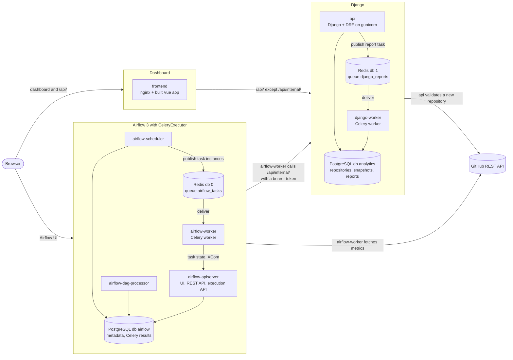
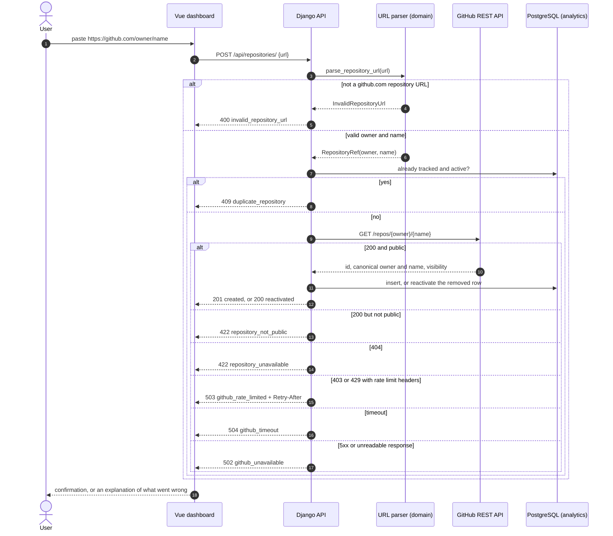
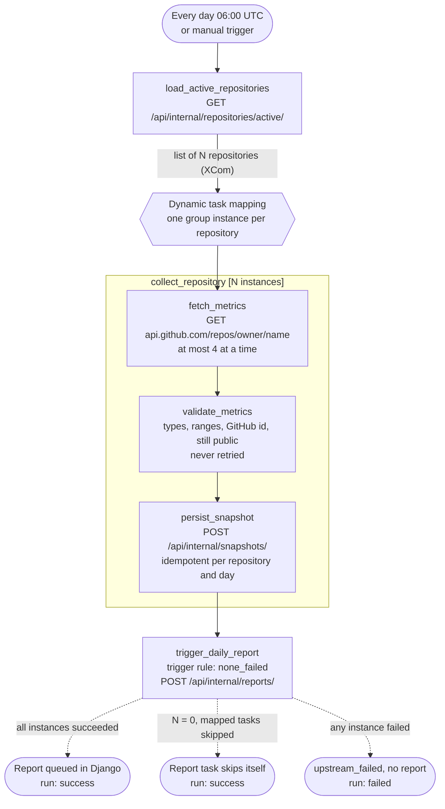
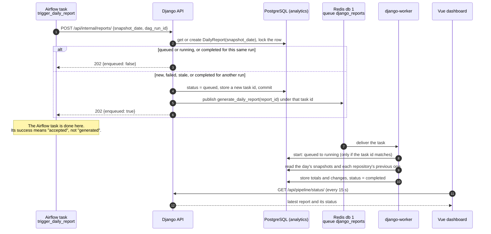
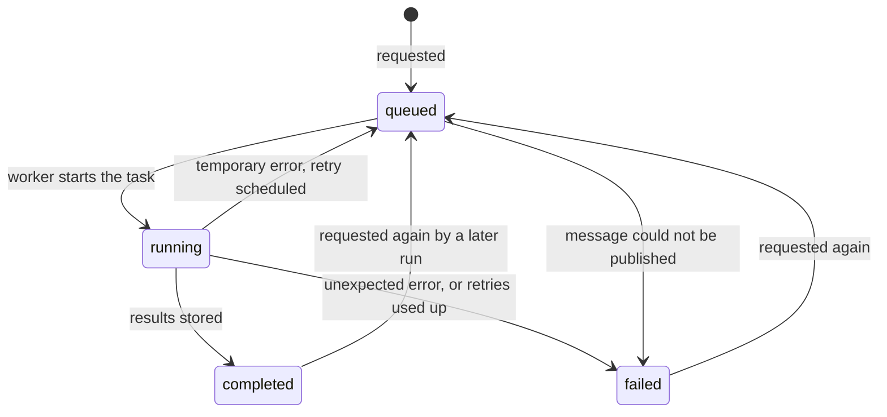
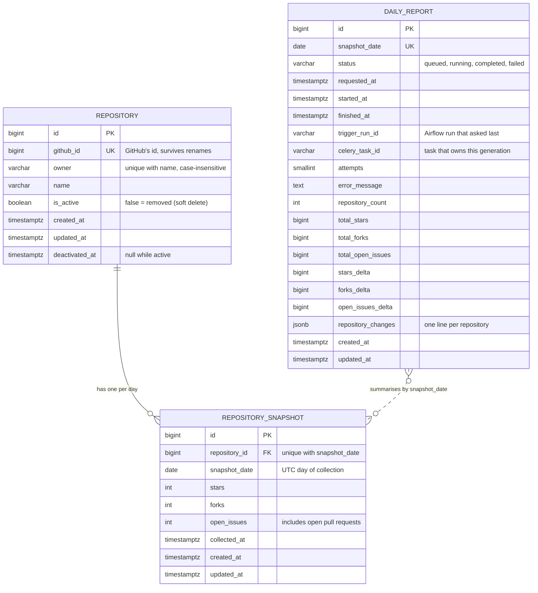

# Diagrams

All diagrams are Mermaid and render directly on GitHub. They describe the system as implemented;
the prose that goes with them is in [ARCHITECTURE.md](ARCHITECTURE.md), [AIRFLOW.md](AIRFLOW.md)
and [CELERY.md](CELERY.md).

## 1. System architecture

Arrows are requests, labelled with what is asked for. Arrows between the coloured groups name the
service that makes the call. The browser only ever talks to nginx and, for the Airflow UI, to the
Airflow API server.

There is **one** Redis container and **one** PostgreSQL container. Each is drawn twice, inside the
application that uses it, because each application only ever sees its own logical database on it.

## 2. Repository creation and validation

The submitted URL is parsed and never fetched. Nothing is stored until GitHub has confirmed that
the repository exists and is public.

## 3. Airflow DAG execution

`collect_repository` is a mapped task group: its three tasks run once per repository returned by
the first task. The dashed arrows show what happens to the report task in each outcome.

## 4. Django Celery report generation

The request only queues work and answers 202. The report's status lives in its database row and
is independent of the Airflow run that asked for it.

## 5. Data model relationships

`DailyReport` has no foreign key: it summarises every snapshot that shares its `snapshot_date`.

